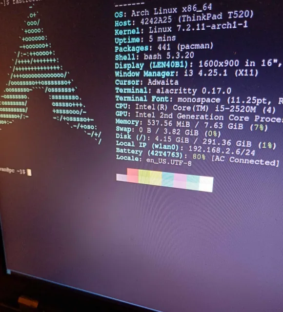

# A very original article, on ThinkPads.
date: 25/10/2026.

A talk about ThinkPads and their philosophy.

## ** Let's skip introductions **.
Thing is, if you are even here, you are probably well versed techonology, enough to know what a ThinkPad is, at least. Their repairability, their rugged almost retro design, and ofcourse, above all, their availability on the used market leading to a pretty cheap price, you can get some for about 100 euro and even cheaper if you know where to look.

## ** ThinkPads and The Modern Age**
Having a ThinkPad nowadays, has become a bit of a contrarian move. Funny how a laptop built for buisinesses has grown to become almost a symbol of anti-consumerism in the world of tech. This is probably due to again, them being massively available for a decent price, and also how they feed this trend of nostalgia for the old digital days. (Which for some reason gets called..analogue? Even though, analogue is a different thing.) Due to their weak hardware, they act as an extension of the UNIX philosophy for software, into the world of hardware. An underpowered ThinkPad, allows you to have it do one specific use. Be it a machine to do homework (Like this used T520 I got for 50 euro, that I am using to write this article) or even a home server.

## ** My opinion on them **
Being a, decently big fan of the UNIX philosophy, I was honestly pretty interested into thinkinkg about these guys. Only recently, did I manage to get my hands on one and..yea the hype does make sense. They have really nice build quality, the keyboard is honestly pretty good. I wont pretend it replaced my main computer, as that isnt what I got it for. Its mainly a device for doing work. It has helped in that regard, simirarly to how my Kindle has allowed me to read, on average, 50 pages a day, which is honestly insane. Also, this laptop has helped me to mess around with Arch Linux a lot, which is always fun. When I got this T520, it was really slugish running Windows 10. With 8GB of RAM and a second gen i5..yea. However, thankfully Arch has seemed to play really well with it, right now I am using only about 1GB of RAM, and thats with a bunch of firefox tabs open.

It honestly runs great, and can easily be used as a daily driver. You can find my dotfiles on my GitHub. I am trying to run a pretty minimal system, so the only really configurable programs I have are i3,NeoVim and Alacritty. Really, all I need is a browser, a terminal, a file explorer and a text editor.

